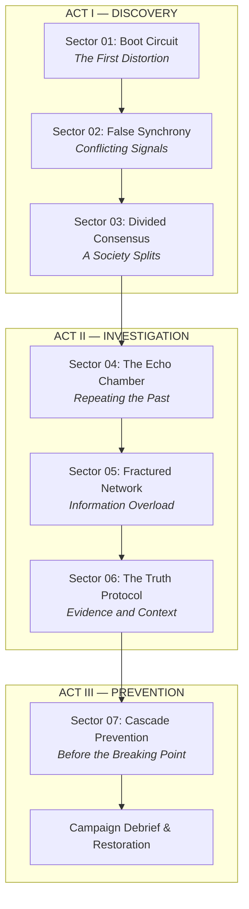

# CAMPAIGN PROGRESSION & NARRATIVE ARCHITECTURE — ECHO-ISM

## 1. Narrative Act Structure

ECHO-ISM's campaign is structured as a continuous investigative journey through the deteriorating infrastructure of **The Network**:

---

## 2. Mechanic Introduction & Cognitive Curve

The campaign introduces one fundamental cognitive concept at a time, ensuring difficulty scales through planning rather than execution reflex:

| Sector | Introduced / Tested Concept | Core Lesson for Player |
| :--- | :--- | :--- |
| **01: Boot Circuit** | Spatial exploration & direct interaction | Understand world controls, switches, and objective markers. |
| **02: False Synchrony** | Precision timing & synchronization | Understand that mechanisms can require timed calibration. |
| **03: Divided Consensus** | Asynchronous past cooperation | Realize an Echo can maintain an action while Live Greg is elsewhere. |
| **04: The Echo Chamber** | Temporal delays & ghost-only sensors | Realize Echoes can trigger delayed relays without player presence. |
| **05: Fractured Network** | Multi-system integration | Synthesize 3 distinct loops to solve a compound multi-room puzzle. |
| **06: The Truth Protocol** | Telemetry verification & circuit repair | Connect puzzle completion directly to authenticating narrative evidence. |
| **07: Cascade Prevention** | Coordinated crisis containment | Plan and execute multi-station stabilization under an active countdown. |

---

## 3. Performance Grades

To reward mastery without creating artificial blockers, each sector tracks three performance tiers:

1. **CLEAR (Standard):**
   - Successfully reach the exit terminal.
   - Unlocks the subsequent sector in the campaign.
2. **EFFICIENT (Advanced):**
   - Clear the sector within the established loop threshold (`attempts <= EfficientLoopThreshold`).
   - Sector 01: 1 Loop
   - Sector 02: 2 Loops
   - Sector 03: 2 Loops
   - Sector 04: 3 Loops
   - Sector 05: 3 Loops
   - Sector 06: 3 Loops
   - Sector 07: 3 Loops
3. **PERFECT (Mastery):**
   - Clear within the efficient loop threshold **AND** locate the sector's optional Recovered Fragment.
   - Rewards a golden mastery insignia on the sector card in Level Selection.

---

## 4. Recovered Fragments & The Archive

Each sector contains one optional narrative terminal placed in a detour or secret alcove. Finding these terminals reveals grounded, human-scale fragments of what occurred prior to Greg's arrival:

| Sector | Fragment Identifier | Fragment Title | Narrative Reveal |
| :--- | :--- | :--- | :--- |
| **01** | `FRAG_SEC01_LOST_TRANSMISSION` | Lost Transmission | First evidence that official warnings were actively suppressed. |
| **02** | `FRAG_SEC02_SIGNAL_ANALYST` | Signal Analyst | Discrepant timestamps show contradictory reports occurred hours apart. |
| **03** | `FRAG_SEC03_MEDIATOR_RECORD` | The Mediator's Record | Proves both districts originally filed identical requests for dialog. |
| **04** | `FRAG_SEC04_ORIGINAL_SOURCE` | Original Source | Compares three revisions of a transmission to demonstrate context loss. |
| **05** | `FRAG_SEC05_NETWORK_ARCHAEOLOGY`| Network Archaeology | Reconstructs the exact timeline of the orchestrated system breakdown. |
| **06** | `FRAG_SEC06_MISSING_WITNESS` | The Missing Witness | Discovers suppressed citizen corrections intercepted before broadcast. |
| **07** | `FRAG_SEC07_FINAL_TESTIMONY` | Final Testimony | The system architect's log on how fear was weaponized through isolation. |

All recovered fragments are saved persistently in `ProgressionManager` and can be re-read at any time in **THE ARCHIVE**.
